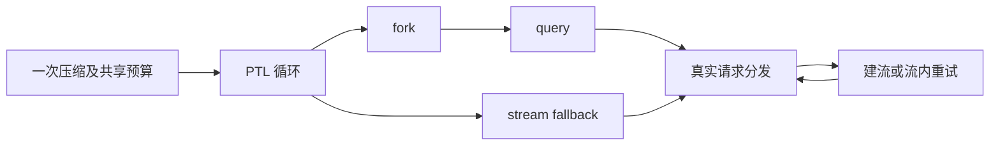
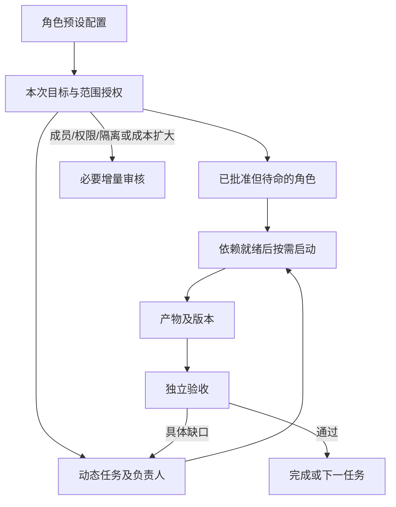

# 执行与团队可靠性设计

本设计在现有运行时、工具、store 和 API 内演进，需求编号沿用 [PRD](prd.md)。实施顺序见 [roadmap](roadmap.md)，实际验证见 [plan](plan.md)。各节以标注的实施状态为准；未取得验收证据的部分继续保持“设计”，不表示现有功能。2026-10-26 的 S3.2/S3.3 已实施并取得离线及浏览器验收证据，2026-10-25 的复核段落保留为历史快照。

## REL-001：Bash 生命周期

现有 `src/utils/Shell.ts` 经 `spawnWithParentProcessGuard` 启动 POSIX 命令，`ShellCommand` 处理取消和进程组。旧守护在额外 fd3 管道 EOF 时杀组，Bun fd 复用/连接失败可能造成误杀。

改进必须保留目标 shell 的参数、stdin、输出和退出结果；生命周期观察器不进入目标 shell 的 job 表，避免 bare `wait` 等待守护。父进程异常退出和 supervisor 终止都要清理目标组；正常结束退出守护。不能孤立改变 detached：组清理依赖组长约束。Windows 保留原路径并说明未验证内容。

## REL-002：一次逻辑压缩预算

预算只属于一次逻辑压缩，不挂全局或会话。本轮默认上限为 6 次真实 provider 请求；不是 6 次外层循环。沿 `compact.ts` → `forkedAgent.ts` / streaming → `query.ts` → `services/api/claude.ts` 传递，在每次真实请求分发前消耗一次。两层重试共用对象，不重复扣同一次请求，耗尽不可作为继续 fallback 的理由。普通对话不传对象，保留原语义。

取消信号在 fork 前后、重试入口、流结束和压缩边界提交前检查；错误和取消不得被摘要文本伪装为成功。临界窗口根据有效窗口、输入估计和安全余量限制输出；空间足够不更改缓存相关参数。显式输出/思考预算、超窄窗口、fallback 都需验证。预算具体上限属于可靠性默认配置，须文档说明，不声称等于历史请求次数。

## REL-003：消息身份贯通

邮箱 ID、transcript UUID、运行回合 ID 是不同概念。一条历史消息可装多封信，必须保留多对一关联；每个用户动作有独立身份，重试复用同一身份但两次同文发送不复用。身份同时限定团队实例、成员和发送者，避免旧实例/他人同文误结算。

复用现有信封可选 ID、消息格式及历史投影；新增内存关联不改变旧数据形状，但改变存盘语义时仍需旧夹具和兼容检查。附件合并有 ID 时按 ID 去重，相同正文和时间戳的不同 ID 必须保留；同一 ID 同时来自 mailbox 与 AppState 只注入一次。旧无 ID 记录仅允许受限内容/时间一对一回退，不为超时自动吞匹配。HTTP 接受不等于 worker 开始，更不等于完成；回复结算以关联回合及合法终态为依据。

## REL-004/005：终态与文本提取

终态持久化与前台展示门控分开审查。合法后台完成不能因前台 ack 未返回丢失，但过期前台输出必须继续隔离。写盘失败不得宣称 durable；多观察者和重复事件不能重复落盘。Telegram/IM 单独验证，不用新的前台 `message_complete` 包装后台终态。

空尾恢复仅在同一合法请求/响应范围内进行。错误、取消、未完成 tool_use 比旧成功优先；不机械倒序找任意非空 assistant。本轮统一复用 `extractResultTextOutcome`：仅合并最终 `message.id` 的 assistant 片段，区分 `ok/no_assistant/cancelled/api_error/incomplete_tool_use/empty`。AgentTool、Skill、前台/后台斜杠命令各自保留失败呈现。

AgentTool 的 `finalizeAgentTool` 仅为 `ok` 创建成功结果，其余结果抛出终态原因，取消复用 `AbortError`。同步和两种后台调用复用既有工具错误、failed 或取消通道，不重复调用 finalizer；同步循环一旦抛错，无论此前是否有文本，都向调用方保留原错误，已产出的部分文本不再伪装为完成结果。同步面板通知使用相同分类：循环错误为 failed，捕获的取消异常或结构化 cancelled 为 stopped，ok 为 completed，其他非成功结果为 failed；已转后台的任务不再发送同步终态。中间分类使用 outcome 的 `cancelled`，不把展示用的 `stopped` 再当作未知失败。

compact 的 fork 与 streaming 两条路径也必须使用该范围：同响应的非空摘要后接空尾时，保留最终消息元数据/usage 并恢复摘要，不浪费预算再次 fallback；不同响应旧成功不可回取。streaming 根据结构化 outcome 拒绝 API 错误、取消和未完成工具，不只检查 `API Error` 字符串前缀；没有该前缀的合成错误也不得落摘要。上下文过长（PTL）文本及 `errorDetails` 仍交给现有截断重试，不冒充成功；取消不得进入 fallback 或提交边界。PTL 返回契约已有回归，完整外层截断循环的请求预算耗尽尚缺端到端证据。

Azure 路径同样在分发前扣预算，但当前错误收尾可能把预算拒绝变成 API 错误消息，丢失结构化预算错误类型；不会因此多发请求，streaming 也会按失败拒绝。该诊断一致性问题保留为后续同区回归任务，不宣称已修。

## REL-006/007：资源和协议

先用合成数据测量读取字节、worker 退出/替代顺序、锁释放和事件循环。worker 复用必须有退出屏障；档案帧数不等于字节成本有界。优化与 Bun 升级分开，真实崩溃不由静态栈推断完成归因。

usage 根据已知协议区分缓存包含/互斥，保留未知语义；MCP 的连接身份不能抹掉项目/scope/凭据隔离；回收规则保护审批、后台任务和终态投递。

## REL-008：三类状态和恢复

- 任务：待分配、待依赖、执行、待验收、返工、完成。
- 活动：启动、模型请求、工具执行、空闲、暂停、失败、未知。
- 投递：已保存、运行时已接受、失败，与对应消息/回合关联。

不以 `in_progress` 或 inbox 文件存在证明进程活着。未知显示为未知，最后有效活动、阻塞原因和下一责任人可查。已有 #1426 supervisor 继续复用；Stop 不被普通广播复活，续跑使用成员自身历史。不确定的副作用要求核实，不能用重试保证“恰好一次”。

## REL-009/010：授权与动态协作（2026-10-26 已实施）

已有 plan 审核约束每成员有任务，启动为全量 prepare。支持待命角色时同时调整校验、稳定成员身份、首次启动、supervisor 和 rehydrate；不能跳过 prepare 后导致无 sessionId 被恢复丢弃。未启动不等于 terminated，首次启动不累计崩溃次数。

使用审批时冻结配置，唤醒不得重新解析被改动的预设。运行范围内任务无需重复审角色；越界仍需授权，更严格全局限制生效。Computer Use 不新增逐应用门禁。

任务交付明确产物版本与验收条件；退回指定差异，相同版本无新事实不重复验。传输确认不强制模型回“收到”，真正行动需求仍可靠唤醒。依赖门控已有成员检查和主控豁免，2026-10-26 起由共享交付协议在所有提交与验收入口统一复查（见下节）。

### 下一实施批次的源码边界复核（2026-10-25 快照）

本节记录当时的缺口，保留为历史快照；下述四条已被 2026-10-26 的实施取代，当前契约见下节。

REL-009/010 当时已在批准计划中，属于待实施工作；只有 REL-011 等额外能力仍需需求触发。当时代码事实如下，以下核对不等于实现：

- `teamPlanStore.ts` 的提交和批准均调用 `validateTeamPlanGraph(..., true)`，同时要求任务存在、每成员有任务；`approvedSnapshot` 已冻结成员、任务和主控模型配置，可继续复用。
- `launchTeamPlanRuntime` 仍先启动所有成员进程；已有依赖等待只推迟指令投递。`rehydrateTeamPlanRuntime` 跳过无 `sessionId` 的成员，不能直接用于尚未首次启动的已批准角色。
- `startWorkerProcess` 在恢复时跟随主控当前权限模式，与“唤醒使用批准时冻结授权”的目标还需协调；更严格的全局限制仍必须生效，不能仅冻结后放任权限扩大。
- 通用 `Task` 仍只有 `pending/in_progress/completed`，并提供 `metadata` 扩展；现有计划“退回”只属于审批前草稿，不是产物验收返工。后续须先确定产物身份、版本及幂等验收契约，再选择最小持久扩展，不能把描述文本当成已实现协议。

下一批须把“已批准未启动”的稳定身份、首次启动、并发任务/指令触发、Stop、服务重启和旧数据恢复一起设计与验证。复用现有 store/service/supervisor 测试，先覆盖“批准后零进程→任务或明确指令→仅启动一次→Stop 不被普通通知复活→重启后仍可首次启动”，再扩展产物验收。缺少浏览器工具仅阻塞实际 UI 验收，不等于尚未实现的服务端逻辑已经完成，也不要求重新批准已明确的产品目标。

### 2026-10-26 实施复核：待命成员、审批快照与交付协议

以下为当前实现契约，证据见 [执行与证据](plan.md)；不把上节快照中的缺口当作仍未实现。

**待命成员与首次启动。** 批准只授权角色和范围，不产生工作：`launchTeamPlanRuntime` 只为拥有“依赖已就绪任务”的成员启动进程，其余成员先取得稳定 sessionId 并写入 roster，然后待命。`initialStartPending` 是唯一的“从未运行”标记；缺该字段的旧团队按“已运行”恢复（`started: !neverStarted`），因此旧的 `awaitingDependencies` 成员仍续跑原 transcript，而不是被当成从未启动而丢掉历史。首次启动成功后清空该标记；启动失败保持待命和可重试，不记为 exited。`firstStartWorker` 以 `resume: false` 开新会话，不计崩溃重启次数。Stop 在 spawn 前递增 `stopGeneration`，首次启动在 spawn 前后比对代次：命中的进程被停掉，不记启动失败，也不清 `initialStartPending`。暂停只把真正启动过的成员标为 terminated，从未启动者保持待命。

**审批快照。** `approveTeamPlan` 在批准时冻结 `approvedSnapshot`（revision、成员、任务、主控 runtime、requestId）。后续唤醒读取快照，不重新解析被改动的预设；同一 requestId 重试返回既有结果而不重复提交；`launchTeamPlanRuntime` 复核 revision 与 requestId，授权被撤销则拒绝启动。`validateTeamPlanGraph(..., true)` 仍拒绝空成员和未指派任务，但不再要求每个成员都有任务，因此“零任务计划”和“无任务成员”都可批准。

**交付协议。** `src/shared/taskDelivery.ts` 定义 schemaVersion 1：`revision`、`submissions[]`（version/artifact/criteria/owner/submittedAt/review）、`receipts[]`（requestId/fingerprint）、`notices[]`。动作只有 submit/accept/return，均带 `requestId` 和 `expectedRevision`；TaskUpdate 的 `deliveryAction` 与普通编辑互斥。submit 仅限当前 owner、任务未完成、上一版本必须已被退回、版本号必须递增，且产物或验收条件至少一项有新事实；accept/return 必须由 owner 之外的独立评审者执行，只能针对最新版本，每个版本只评审一次。状态由协议派生：submit/return 为 `in_progress`，accept 为 `completed`。

**幂等与并发。** 事务内按 requestId 查 receipt：同 requestId 同 fingerprint 是重放，直接返回；同 requestId 不同 fingerprint 拒绝；`expectedRevision` 不符要求刷新。accept 先在锁内校验，再在锁外执行完成 hook，最后重新取锁复验 revision、身份、owner 和审批后提交。因此并发 accept/return 只有一次落盘，过期版本不能获胜。

**取消、锁与依赖。** 取消信号在入口、hook 前后和写入事务内检查；hook 阻塞或取消时不提交 receipt，已取消的 accept 不能跳过否决型 hook 提交。REST 交付端点把请求 signal 传入同一路径，客户端取消返回冲突而不是成功。submit 与 accept 在事务内复查 `blockedBy` 的每个任务仍为 `completed`，缺失或重新打开的阻塞项直接拒绝。成员普通 TaskUpdate 在 hook 前预检并在实际写锁内复查依赖，显式主控豁免保持不变；两条原子认领路径与 supervisor 的首次启动、空闲唤醒、主控阻塞说明统一使用 `findUnsatisfiedBlockers`，只有依赖任务存在且已完成才算满足。无法读取交付历史的任务不进入可执行任务集合。

**owner 释放与返工改派。** 成员退出走内部释放选项：只能清空 owner，不能改派或改写历史；仍在待验收的版本保持 `in_progress`，不把评审中的工作退回池子。普通编辑只有在最新版本已退回且任务未完成时才允许改派，且新 owner 仍需在批准范围内。交付任务不可删除；无法读取的任务既不可删除也不可重写。

**只读与未知 schema。** 缺少 `delivery` 的旧任务迁移为空历史，不会被推断为已验收。无法解析或版本更新的记录保留原始字节与 mtime：读取时在内存中保留原件，对外投影空历史和 `deliveryError`；任务在丢弃 `completed` 后按 `in_progress` 失败关闭，不能作为已完成依赖；任何写入与删除都抛出同一只读错误。TaskGet 打印只读原因而不是空历史；TeamService 的 workbench 投影删除原始记录；桌面交付面板显示中性原因，隐藏版本历史和 accept/return。

**范围。** 上述守卫以“已有交付版本或无法读取”为条件；没有任何交付历史的普通任务继续使用原有 TaskUpdate 完成方式，不声称所有任务都强制交付。

## 2026-10-27 边界补缺设计草案（未批准）

本节保留只读审计后的差异设计，不覆盖前文已实现能力。2026-10-27 后续授权更新：用户已授权继续后续开发，并批准 P0-B 隔离行为探针及合同闭合；当前不修改生产实现，P2/P3 仍须通过对应 Design Gate。下文早先的“仅文档授权／未授权编码”是政策确认时的历史范围，不否定后续授权，也不使未闭合的实施合同自动获批。执行编排见 [Plan 的边界补缺草案](plan.md#2026-10-27-压缩与-teams-边界补缺草案未批准)。

**Teams 补缺 Design Readiness=not-ready；delivery_status=planned。** Teams 尚未运行新红例，Stop 持久化与消息写入的并发合同未闭合，权限政策 A 已于 2026-10-27 确认，但其实现合同仍有承重缺口；不能以原计划批准或历史门禁通过代替本节批准。BG-C1/C2 以下保留审计时机制与修正依据，P1 已获单独批准并实施，运行结果只在 Plan P1 记录。本节未做独立实现模拟评审；在承重事实和决策闭合后，只针对最终受影响设计安排一次独立复核。

### BG-C1：REL-002 高 thinking 输出 cap

- `evidence_status=verified`：`src/services/compact/compact.ts` 的 `getCompactForkOutputCap` 检查 `budgetTokens + 1`，但返回时再次取 `COMPACT_MAX_OUTPUT_TOKENS=20000` 的最小值；`src/services/api/claude.ts` 按 `maxOutputTokens - 1` 调低手动 thinking。这是已核实的源码机制，不是本轮运行复现。
- 反例：有效输出上限 32000、thinking 25000、可用输出空间 26000，floor 检查通过但最终 cap 为 20000，thinking 会降为 19999。需保留模型支持手动 thinking、cache-sharing 开启和有 measured usage 等前置条件。
- 最小修正提案：不提高压缩 20000 上限；先算最终候选 cap，再验证其满足既有合法输出 floor，不满足则返回 declined，沿既有 streaming 路径处理。正常宽裕窗口继续 keep-cache-key，用户自身低输出上限的既有语义不变。最大代价是该边界放弃 fork 缓存共享；替代方案是提高压缩上限，但会改变成本默认值，本次不采用。
- 可证伪验收：高于／等于／低于 20000 的 thinking 边界、合法低预算、宽裕窗口、无 measured usage、用户低输出上限；至少一个用例从压缩分发入口证明非法 cap 未传给 fork。若 streaming 路径另有预算策略，只证明本次 fork 不静默降低配置，不扩大成所有 provider 都已验证。

### BG-C2：REL-002 Azure 错误类型与 PTL 全循环

- `evidence_status=verified`：`src/services/api/claude.ts` 的 Azure 分支在分发前扣请求预算，但 catch 将预算耗尽转换为普通 assistant API error。当前证据不支持“会超发请求”的结论。
- 最小修正提案：只让 `isRequestBudgetExhausted` 匹配的错误沿现有结构化耗尽通道传播；保持其他 Azure 错误、取消和普通非预算请求行为。不得顺带重构 provider 错误体系。
- PTL 属于 `test gap`：`compactConversation` 和 partial 外层已传同一预算，但已有 PTL 用例只证明单次返回契约。补 full/partial 外层实际截断重试的 loopback 计数，预算耗尽时无第七次请求、无新 fallback、无成功 boundary；在重试前取消时计数不再增长。若红例通过，只补验收证据，不强行修改生产代码。

### BG-T1：REL-008/009 Stop 跨恢复与并发

- `evidence_status=verified`：`pauseLaunchesForLead` 将 pausedAt/resumeAllowedAt 留在内存，持久更新只给已启动成员写 terminated；`rehydrateTeamPlanRuntime` 不恢复暂停意图。
- `evidence_status=inferred`：Stop 后为待命成员出现 ready task，再恢复 runtime 且主控存活，可能自动首次启动；必须用真实生命周期入口固定红例，不能只根据字段缺失宣布已运行复现。
- 不变量沿用既有需求：Stop 后旧 lead/peer 消息、任务变化和服务恢复本身不构成继续授权；用户对成员的新指令，或用户重新联系主控后产生的合法主控指令，才沿既有规则恢复。没有自然语言“继续”关键词解析，也不扩大成自动重放工具副作用。
- 最小方向是把暂停意图放入既有团队持久记录并在 rehydrate 前恢复，不新建任务／恢复存储。下列源码取证已明确现行顺序和作用域；持久化失败的最终安全状态、并发 Stop/继续的持久代次、旧数据兼容及旧版本回退仍未形成实施合同。上述合同未闭合前不确定字段名、不写迁移代码。
- 替代方案“恢复后所有团队一律暂停”更简单，但会改变未 Stop 团队的恢复语义；仅靠 terminated 无法区分用户停止和崩溃，也不能表示尚未启动成员，均不直接采用。
- 必需证据：真实 Stop 入口→磁盘状态→独立服务进程重启→读取/重连不启动→合法新指令才启动；另覆盖 Stop 落在 spawn 中、继续与再次 Stop 并发、旧记录及持久写失败。内存 forget/rehydrate 仅作为聚焦测试，不替代进程重启证据。

#### T1 暂停持久化合同（2026-10-27 实施）

- **数据（已实施）**：团队配置新增可选 `pausedAt: number`，语义为“用户最近一次 Stop 的时间”。缺失表示从未 Stop，因此旧团队文件与旧版本记录保持原语义，不需要迁移改写；未知字段继续保留。它记录的是团队级 Stop 意图，覆盖该团队下当前与归档的 running plan。
- **提交时点**：Stop 先同步关闭内存准入（`pausedAt`、`stoppedByUser`、`stopGeneration`），再在既有 Stop 写盘内一并写入 `pausedAt`，与成员 terminated 标记同一次 config mutation 提交。恢复内存准入不等待该写盘；写盘失败只记录错误。
- **恢复**：`rehydrateTeamPlanRuntime` 从团队配置读回 `pausedAt` 并放入 launch，supervisor 的既有暂停门禁因此在恢复后继续生效——ready task、peer 通知、task-list 通知都不能让待命成员首次启动；只有用户直接指令，或用户重新联系主控后产生的主控指令才能解除。`resumeAllowedAt` 不持久化：重启后必须由用户重新说话才允许主控解除暂停。
- **解除**：暂停被解除时同步清除持久 `pausedAt`，并以“只清除本次被解除的那个时间值”为条件，避免与并发的新 Stop 互相覆盖。
- **失败与残余窗口（已实证）**：若 `pausedAt` 写入失败，Stop 只在当前进程内生效；服务重启后该团队按未 Stop 处理并可能自动启动成员。这是本合同的已知边界：不引入“所有崩溃都待确认”的全局标记，也不以内存或第二份同盘文件冒充保证。UI 目前收到的是既有 Stop 结果，不单独区分“已停但未持久化”；该可见性属 F2 待闭合项。
- **兼容与回退**：`pausedAt` 为可选字段，旧程序读取时忽略，不会改变旧程序的恢复行为；因此把“新版本写下的停止意图”降级到不认识该字段的旧版本时，暂停不再生效，属于必须披露的回退限制。
- **验证**：`teamPlanRuntime.supervisor.test.ts` 新增“Stop 跨运行时存活”回归（先 RED）；跨两个真实 OS 宿主进程的探针同时覆盖正常与写失败两种场景。

#### T1 源码取证：暂停、停止与恢复的现行边界

以下 `verified` 只表示当前源码可核验，不是运行复现或设计批准。

- **入口及顺序（verified）**：WS `stop_generation` 经 `handleStopGeneration` 调用 `conversationService.sendInterrupt`；后者同步调用暂停 listener，再停止 child sessions，随后排队撤销未完成 launch，并发送 `team_plan_pause`。HTTP 协作组 Stop 经 `sessionCollaborationHost` 的 `stopSessionTurn` 复用这一停止路径。旧 `/api/sessions/:id/chat/stop` 只改旧 chat 状态，不能作为团队暂停入口。锚点：`src/server/ws/handler.ts:828,1310,2498`、`src/server/services/conversationService.ts:1251-1283`、`src/server/services/sessionCollaborationHost.ts:174`、`src/server/api/conversations.ts:137-141`。
- **写入与异常（verified）**：`pauseLaunchesForLead` 同步设置内存 `pausedAt`、清除 `resumeAllowedAt`，对所有 worker 取消自动继续并递增 `stopGeneration`；异步 config mutation 只把已启动成员写为 inactive/terminated。调用者不等待该写入，失败仅日志，没有持久暂停记录或回滚。故不是“写盘成功后才杀进程”。`stopSession` 先删会话 Map 再 kill，kill 异常只警告，也不能当作 OS 进程已退出的证明。锚点：`src/server/services/teamPlanRuntime.ts:751-776`、`src/server/services/conversationService.ts:1791-1792,1863-1867`。
- **恢复（verified）**：`rehydrateTeamPlanRuntime` 要求 running plan、approvedSnapshot、匹配 lead/incarnation；`initialStartPending===true` 才表示从未启动，缺字段按已启动兼容；`awaitingDependencies===true` 才重建 brief。新 launch 不回填 pausedAt/resumeAllowedAt，stopGeneration 重建为 0，terminated 也不被解释为暂停。恢复先注册 supervisor，不立即 spawn；主控启动 hook 或 plan GET 的 `getForSession` 可触发恢复，并非发现了开机无条件全盘恢复。锚点：`src/server/services/teamPlanRuntime.ts:830-838,1038-1111`、`src/server/services/teamPlanService.ts:25,44-47`、`src/server/api/teams.ts:52-53`。
- **触发条件（verified）**：同服务内暂停仅被 Stop 后用户直发，或用户重新联系主控后符合时间边界的主控消息解除；ready task 本身不能解除该内存暂停。恢复后该门禁不存在：有 brief 的成员可在主控存活且任务 ready 时首次启动；无 brief、无进程的成员不会单靠 ready task 启动，但符合条件的未读消息可触发 restart。因此“所有成员重启后都被 ready task 唤醒”不成立。锚点：`src/server/services/teamPlanRuntime.ts:596-624,675-728,789-792`。
- **多 plan 与并发保护（verified）**：同一主控可有当前及归档 running plans；Stop 按 parent session 暂停所有 running launch，恢复消息清除的是命中成员所属的整个 launch。worker.starting、stopGeneration 和 supervisor 防重入提供局部保护；teamStopOperations 只串行后续撤销，不等待暂停 config 写入。锚点：`src/utils/swarm/teamPlanStore.ts:141-143`、`src/server/services/teamPlanRuntime.ts:337-364,403-404,734-757,1091-1111,1162-1172`、`src/server/services/conversationService.ts:1267-1275`。
- **仍未知（research-required）**：supervisor 暂停检查后仍有 await，投递前没有统一暂停/代次复核，不能据局部保护证明任意并发都无后续投递；具体时序、写失败后跨服务安全状态及进程终止失败的可观察行为须后续隔离红例。新旧记录怎样表达暂停、Stop 与继续何时提交、同毫秒时间比较和回退安全性属于待闭合合同，不能由此次只读检查标为通过。

### BG-T2：REL-003 成员消息实例边界

- `evidence_status=verified`：桌面 `sendMemberMessage` 和服务端 POST 只传 content/messageId，`TeamService.sendMemberMessage` 按当前 teamName/agentId 查成员后写邮箱，没有请求实例校验。
- `evidence_status=inferred`：同名团队及成员重建后，旧延迟请求可进入新实例。需以延迟请求／删除重建的受控时序复现。
- 最小方向：复用现有团队 incarnation 与成员 session 身份，从绑定成员页透传，在服务端写入前验证；messageId 继续只负责同一次发送的幂等。冲突时不写 live/history、不自动对新实例重试；UI 保留可编辑正文并提示刷新，不能悄悄转投。
- **锁边界已核实（verified）**：创建 `TeamCreateTool.ts:163-205` 和删除 `teamService.ts:2422-2446`／`teamHelpers.ts:922-991` 共享 canonical task-list lifecycle 锁，其锁文件位于实体目录外；创建 config 另取 config 锁。发送 `teamService.ts:1848-1893` 不取上述共同锁，`teammateMailbox.ts:479-571` 仅取成员 inbox 锁，且建目录/文件在 inbox 锁之前。现行结构不能保证“查询旧成员→提交邮箱”与删除重建串行。复用 lifecycle 锁是候选方向，不是已实现的提交隔离；还须闭合成员替换路径与锁顺序，不能只在 POST 开头或提交后加复查。
- **身份与幂等已核实（verified）**：agentId 是可复用的 `name@teamName`；incarnationId 是 name/leadSessionId/createdAt 元组散列，不是独立随机代次。process 成员 sessionId 是 launch 生成并供恢复复用的 UUID，但 legacy 成员可缺失；planMemberId 和 planId 均不能直接代替整个团队代次。另有 lifecycle generation 可跨同名重建递增，发送当前没有读取它。messageId 仅在保留且可读的单成员 live/history 内去重，删除团队后不提供跨代保证。锚点：`src/utils/agentId.ts:38-39`、`src/server/services/teamService.ts:363-367`、`src/server/services/teamPlanRuntime.ts:916-917,1047-1058`、`src/utils/tasks.ts:1165-1172`、`src/utils/teammateMailbox.ts:328-335,561-576`。
- **调用范围与可达性（verified／unknown）**：仓内 `sendMemberMessage` 主链仅为桌面 store→桌面 API→HTTP→service；CLI @成员、SendMessage 和 backend 是直接邮箱旁路，不自动纳入本 HTTP 修复。桌面已有 incarnationId/member sessionId，但发送未透传；UI 隐藏归档输入不等于 store 或服务端禁写。server DELETE 要求主控 inactive 且无注册成员，不能声称任意活跃团队可随时删除。锚点：`desktop/src/stores/teamStore.ts:1729-1780`、`desktop/src/api/teams.ts:109-120`、`src/server/api/teams.ts:155-168`、`src/server/services/teamService.ts:2434-2437,2665-2691`。仓外或动态构造 URL 调用方未知；实际可达的迟到请求、成员替换和删除/重建时序仍需受控红例。
- **兼容政策已确认（2026-10-27）**：业务真源为 [REL-003-M1](prd.md#rel-003成员消息实例绑定2026-10-27-确认)。用户接受缺实例身份即拒绝旧成员消息 HTTP 请求，live/history 零写入；不按当前同名团队补身份，不自动转投。客户端升级／刷新取得绑定身份后，由用户重新发送。不得调用会创建邮箱目录/文件或追加历史的写路径来完成缺身份请求；不以 messageId 幂等代替实例校验。仓外调用方未知，未升级调用方发送失败是本次明确接受的兼容代价，不采用延后切换或无条件 name-only fallback。此结论变化源于用户决策，不是新增运行证据；本次仅更新文档，不授权 P2 编码。
- **仍未闭合的实施合同**：完整身份的字段、来源及缺失/无效/冲突的错误协议，legacy 成员缺 sessionId 时的可信绑定方式，成员替换与删除重建的共同锁边界、锁顺序及提交隔离仍须设计验证。不能从“缺身份拒绝”推断“完整身份提交已安全”；也不能由用户确认消除 incarnation 生成与代次唯一性方面的事实缺口。保持 Design Readiness=not-ready，不修改其他邮箱入口协议。
- 必需证据：正常发送、同实例重试只写一次、跨实例相同 messageId 不投递、旧请求迟到、验证与提交之间重建、归档只读，以及冲突 UI。不改其他 SendMessage 工具协议，除非调用方盘点证明它属于同一入口的必要影响面。

#### T2 请求身份合同（2026-10-27）

- 范围为成员页 HTTP 写入口，不改变 CLI/SendMessage 邮箱旁路。客户端从该页面已绑定的 `team.incarnationId` 与 `member.sessionId` 原样发送 `incarnationId`、`memberSessionId`；不以 teamName、leadSessionId、推测值或重试时的新快照补齐身份。
- body 必须是对象且 content 为非空字符串；缺身份、错误类型、非法 messageId 返回 400。团队不存在或成员不在当前 roster 返回 404；团队 incarnation 不匹配、成员 session 不匹配或 legacy 成员缺 session 返回 409。只有 inbox 历史记录的成员仍可读，不能以猜测的 sessionId 写入。拒绝发生在调用邮箱写路径之前，不创建目录、不改 live/history；同 messageId 重试也必须先验证身份。
- 成功保持 200 `{ok:true}`，表示邮箱接收而非执行完成。同实例重试沿用已有 messageId 去重；失败向现有 composer 传播，保留正文，不自动换身份再发。客户端缺可信身份直接拒绝，刷新后只能由用户重新发送。
- 不新增持久格式，不修改旧历史，不做身份迁移。代价是旧客户端和缺 session 的历史成员不能继续使用此写入口；这是 fail-closed，而非替它们绑定当前实例。回退不得单独恢复 name-only 服务端，否则会重新开放错投窗口。
- 此小节只闭合请求准入；并发期间的完整提交仍必须覆盖 lifecycle→config→inbox 共同锁与受控交错验证，不能用本节测试替代。team incarnation 仍依赖现有元组，不宣称任意手工复刻 config 可被区别。T2 整体 Design Readiness 仍 not-ready，直到原子提交合同与独立模拟完成。

#### T2 原子提交合同（2026-10-27）

复用 `withTaskListLifecycleLock(getCanonicalTeamTaskListId(teamName))` → `withTeamFileLock(teamName)` → `writeToMailbox` inbox 锁。config 锁内读取最新 roster、验证完整身份、解析收件人并完成邮箱提交；禁止在该回调内再次调用 config mutation（不可重入）。生命周期锁排除受支持的删除重建，config 锁排除成员注册/替换/移除。缺团队保持 404，不因锁需求创建团队。入口缺身份在获取锁前拒绝。

线性化语义：替换先提交则旧请求 409/404 且零邮箱写入；发送先获锁则以旧身份合法提交，替换等待发送结束。该保证不等于旧成员已接收的消息永不被以后复用同名 inbox 的成员读到；消费侧 envelope 身份隔离、历史部分提交及手工复刻创建元组不由双锁解决，继续作为 T2 整体验收缺口。邮箱 I/O 失败沿既有 503，不追加自动重投/回滚；锁 finally 释放，下一请求能继续。

必要配套：runtime 的 Stop 撤销、reviewRequired 初始化、成员注册三处旧快照整写改用现有 `mutateTeamFileAsync`，在同步回调内检查代次和更新成员；否则旧快照会恢复已移除身份或覆盖暂停字段。初次创建仍保留原初始化函数，不改通用旁路协议、不引新锁层。用成员解析 barrier、真实锁获取观察验证两种先后顺序；完整删除重建/消费边界不得被该局部用例替代。此合同解决当前复现的提交窗口，不将 T2 整体 Design Gate 升为 approved。

**消费侧事实补充（2026-10-27）：** 隔离探针通过真实 `cleanupTeamDirectories`/`beginTaskListLifecycle` 重建，同名但 lead/member session 均不同；旧身份调用公开 `takeTeammateMailbox` 仍领取新 envelope，新消费者随后无消息可领。消费 API 仅使用 teamName/agentName，inbox 锁只防重复领取，不校验消费者实例。该事实将“可能误消费”提升为公开入口可复现缺口，但未证明完整旧 runner 在正常销毁链中会残存。修复需闭合各消费入口的实例来源、read/claim 的共同生命周期边界、legacy 行为与停止旧消费者策略，不能仅加锁前一次身份读取。现有 HTTP 提交合同保持有效，消费侧 Design Readiness=not-ready；本批不擅自扩展 CLI/SendMessage 持久协议。

#### T3 停止水位合同（2026-10-27）

- **数据**：团队 config 新增可选 `stopEpoch: number`，与 `pausedAt` 同一次 Stop 的既有 mutation 内写入，值为读取到的当前值 +1；缺失视为 0。它是“用户停止过几次”的单调计数，不是时间，因此不受跨进程时钟影响；`pausedAt` 继续只负责恢复门禁。团队被删除重建时随目录一起消失，新团队从 0 开始，配合已有 incarnationId 区分实例。
- **生产点**：只有用户 Stop（`pauseLaunchesForLead` 的成功落盘）递增。恢复、任务完成、成员失败、服务重启都不递增；重启读回的是同一值。写失败时本轮不递增，即“未确认停止”，与 T1 已披露窗口一致。
- **下发**：团队详情与 workbench 的 `team.stopEpoch`、`team_update` 事件的 `stopEpoch`（缺省不补 0，避免把旧服务端伪装成新语义）。
- **发送侧线性化**：成员消息在已持有的 config 锁内读取该值并在 200 响应返回 `stopEpoch`；新版服务在旧 config 缺字段时明确返回基线 0，不改写旧 config，缺响应字段仅表示旧服务不支持该协议。桌面把发送成功响应中的值记为该条等待的 `stopEpochAtSend`；缺失则不结算。因此“发送先提交”的记录旧值，“停止先提交”的响应直接带新值。
- **结算规则**：仅当收到同 incarnation、同 lead 的 `team_update` 且 `stopEpoch > 等待记录值` 时，判定该等待被停止结束：移除等待、清掉“思考中”，保留正文与历史，不写回答、不标记失败、不自动重发。比较是严格不等式，所以迟到且相同/更旧的快照不会清掉 Stop 之后的新发送；成员本来停止时用户新发的消息同样因相等而不被结算。
- **不结算的情况**：响应缺 `stopEpoch`（旧服务端）、团队实例不匹配、成员不属于该团队、消息尚未发送成功。
- **UI**：仅停止显示中的 thinking；不新增成功/失败文案。用户重新发送是新的等待，由下一次 Stop 单独结算。
- **兼容与回退**：字段可选、旧 config 无该值为 0；旧客户端忽略新字段；回退桌面端回到“只在回答/失败时结算”，回退服务端则 `stopEpoch` 仍保存在 config 中但不递增。无迁移、无历史改写。
- **验证**：服务端 Stop 两次递增并跨重启保留；HTTP 发送返回锁内值；桌面“Stop 结算已发送等待”“迟到旧快照不结算新发送”“成员原本停止时新发送不被结算”。真实浏览器 Stop 链路归 P3。

### BG-T3：REL-003 Stop 与成员等待结算

以下保留实现前的诊断事实；当前设计以此前「T3 停止水位合同」为准，实际实现与验证状态见 Plan P2-3，不将历史“没有停止代次”的描述误读为当前代码状态。

- `evidence_status=verified`：`syncMemberSessionMessages` 的终态只包含 completed/团队删除；新 error 或关联回答可结算，但 stopped activity 本身不结算，unsettledReplies 还能使 isActive 为 true。
- `evidence_status=inferred`：发送未答时 Stop 后仍显示 thinking。需经实际 store patch／同步路径复现，并检查其他清理入口是否已处理具体场景。
- 最小方向：以同实例、同成员、发生在发送之后的停止边界结束此前等待，保留正文／历史，不伪造回答或失败。不能仅见 activity=stopped 就无条件清空：成员原本 stopped 时用户的新消息是合法唤醒请求；旧异步快照不能结算 Stop 之后的新发送。
- **现行信号已核实（verified）**：`src/server/ws/events.ts:149` 的 team_update 带团队/成员及可选实例身份，没有停止代次或单调事件 revision；`team_plan_updated` 的 plan revision 不能代替成员停止次序。`teamStore.ts:900-945` 的 stream revision 保护转录/流合并，停止不在等待结算条件里；`memberReplySettlement` 优先 envelope ID，旧记录才走正文及 120 秒回退。锚点：`desktop/src/stores/teamStore.ts:605-649,907-945`。
- **结论边界（inferred／research-required）**：现有身份足以隔离不同成员/团队，但没有已证明能裁决“旧 stopped 快照 vs 新发送”的端到端停止序号。REST workbench 的内容 hash 与 taskListRevision 不能据名称当作停止 epoch；HTTP/WS 交错覆盖风险尚未运行复现。停止边界的生产者、持久位置、接收规则和兼容必须在 Design 闭合，不能仅以客户端墙钟或 stopped 字符串清空等待。
- 必需证据：回声前 Stop、回声后回答前 Stop、取消、旧 stopped 快照迟到、新消息唤醒、Stop 后明确继续、无关成员终态不串结算；正常长延迟与同文不同 ID 回归保持。

### BG-D1：REL-009 批准后权限政策与差异合同

**已确认政策：** 用户于 2026-10-27 选择 A，业务真源见 [REL-009-A1～A5](prd.md#rel-009团队权限上限2026-10-27-确认)。政策选择的 decision-gap 已关闭；下述实现设计为 proposal，尚未批准编码，BG-D1 的 **Design Readiness=not-ready**。结论变化源于用户明确政策选择，不是新增运行证据。

#### 已核实事实与差异

- `src/shared/teamPlan.ts` 的 `approvedSnapshot` 冻结成员/任务/主控 runtime，没有独立的批准权限上限；`teamPlanRuntime.ts:startWorkerProcess` 每次启动重读主控当前 permissionMode。`agentPresetValidation.ts:validateAgentPresetSnapshot` 对 default/未指定模式放行继承。现状与新确认的 A 不一致，但尚无本轮运行红例。
- `teamPlanService.ts:approve` 通过 planId/sessionId/incarnationId/revision 校验并调用 `teamPlanStore.ts:approveTeamPlan` 落盘后启动；同 requestId 支持重放。它是初次整队批准入口，不是已经具备的增量权限 API；不得直接拿重新批准整队代替增量授权。
- `conversationService.ts:setPermissionMode` 等待控制请求和 runtime status 确认；`ws/handler.ts:applyPermissionModeToActiveSession` 在部分活跃回合会 defer。该能力可作为候选接线点，但不能证明运行中成员及时收紧、多个成员原子切换或落盘与 runtime 一致。

#### D1 源码取证与剩余缺口

本节记录四路取证中的权限事实；`verified` 不表示已运行权限测试，也不构成新的授权政策。

- **F1：模式不是全序（verified／research-required）**。`src/types/permissions.ts:16-38` 的用户可指定集合含 acceptEdits/bypassPermissions/default/dontAsk/plan，auto 受编译开关控制，bubble 仅为内部类型。`getNextPermissionMode` 是 UI 循环，不是强弱关系。`permissions.ts:231-238` 明确将 `plan && isBypassPermissionsModeAvailable` 纳入 bypass 判定；plan 的模型只读指令不能代替硬只读执行边界。dontAsk 把 ask 转 deny，acceptEdits 有路径/安全条件，auto 还有分类器，因此不能用固定 rank 或“默认降为 plan”构造安全交集。现有取证未产出全部受支持组合的能力裁决表，不将 F1 关闭；下一步仅针对有效权限算法会使用的组合，沿共享工具判定及明确 allow/deny 规则完成合同，不重写权限引擎。锚点：`src/utils/permissions/permissions.ts:537-569,1209-1335`、`src/utils/permissions/filesystem.ts:1239-1397`。
- **F2：确认不等于中止（verified／research-required）**。WS 在 `activeUserTurns.messageSent===true` 时 defer，正常 result 后才 apply，且不判断扩大/收紧。底层 `ConversationService.setPermissionMode` 可对现存 worker session 发控制，等待 control response 及目标 mode status；这不证明已有专用成员权限 UI。直接 CLI control 更新 AppState，但未见统一 abort/撤销已获 allow 的工具；工具判定与 tool.call 之间也不是权限变更事务。故新工具准入栅栏、已执行工具的中断边界、超时最终状态及收紧确认仍须设计和隔离验证。锚点：`src/server/ws/handler.ts:1539-1577,2056-2081`、`src/server/services/conversationService.ts:1139-1192`、`src/cli/print.ts:3174-3188`、`src/services/tools/toolExecution.ts:942-952,1227-1243`。
- **F3：初次批准有局部一致性，但没有权限上限事务（verified／research-required）**。store 在 lifecycle 锁内校验实际团队及 plan 身份；同 requestId 的已提交批准先于 revision/state 检查返回，不重复启动。首次校验在锁外，revision 二次比较保护 plan 变动，但当前主控权限并未作为独立版本进入批准快照。每次 worker start/resume 又重读主控 mode；因此 plan 锁不能独自保证批准、外部限制变动与 spawn 的共同裁决。现有批准不能直接当作带载荷指纹的增量批准 API。锚点：`src/utils/swarm/teamPlanStore.ts:85-88,193-204`、`src/server/services/teamPlanService.ts:89-108`、`src/server/services/teamPlanRuntime.ts:127-139,297-321,879-893`。
- **F4：旧记录不能证明历史主控上限（verified／decision-gap）**。schemaVersion 1 的 approvedSnapshot 只含 revision/members/tasks/leaderRuntime/approvedAt/requestId；成员 preset.permissionMode 表示预设约束，不是批准时主控上限。passthrough 能保留扩展，不等于旧 runtime 能执行其语义。现有 plan/read/rehydrate 无从补回缺失的历史上限；此次未读真实团队，不声称所有旧记录都缺字段或历史分布已知。无可信证据旧团队的执行范围已由用户确认 A4，见下节“旧团队重新确认规则”；该 decision-gap 已关闭，但不补回未知历史事实。迁移及回退合同仍待闭合，须保留原记录和未知字段，旧版本忽略新限制时不得自动恢复。锚点：`src/shared/teamPlan.ts:12-26,55-85`、`src/utils/swarm/teamPlanStore.ts:21-30,202`、`src/server/services/agentPresetValidation.ts:24-31`。
- **更严限制的来源（verified）**：显式 deny、组织规则、mode capability gate、sandbox 及 Computer Use 全局禁用/OS 权限分布在现有判定与执行层，不能压缩为一个 mode 字符串。取证不授权增加逐应用 Computer Use 提示。锚点：`src/utils/permissions/permissionsLoader.ts:28-35,99-132`、`src/utils/settings/applySettingsChange.ts:42-73`、`src/tools/BashTool/shouldUseSandbox.ts:135-140`、`src/vendor/computer-use-mcp/toolCalls.ts:963-1070`。

#### 最小设计方向（proposal，非新增业务授权）

1. **授权与有效权限分开。** 在既有 plan 持久记录内保存初次批准上限及后续明确批准的增量，不以主控当前模式反推历史授权。成员启动/恢复时同时受已批准上限、冻结预设约束和当前更严限制约束；权限收紧不擦除批准记录，也不产生未来扩大授权。限制解除后的恢复时点仍须在模式关系合同中明确，不能自动当作新批准。
2. **比较按能力，不排序字符串。** `permissionMode` 不是天然全序，不直接对 default/plan/acceptEdits/auto/bypassPermissions 取 min。应基于当前工具判定、显式 allow/deny、组织策略及模式转换规则，逐对证明“等价、收紧、扩大或不可比较”。不能证明不扩大的转换不得自动通过；不可比较时是否保留旧模式或暂停受影响工作，需要模式映射取证后定稿。不得另造一套与 CLI 判定不一致的权限引擎。
3. **增量批准仅改变授权，不隐含启动或继续。** 候选入口放在现有 Teams 批准/成员检查界面，展示当前上限、请求权限、受影响成员、仍生效的限制及变更原因；可信用户明确确认才提交。模型只能提出请求，不能执行批准。取消或拒绝保留原授权；已 Stop 的团队获增量批准后仍保持 Stop，继续遵守 BG-T1。
4. **数据与接口最小合同。** 拟复用 planId/incarnationId 与成员稳定身份限定授权对象，expectedRevision 防旧页覆盖，requestId 仅作同一批准动作幂等。批准记录至少表达来源、授权范围、旧/新上限、批准版本和确认时间；这些是必需语义，不是已定稿字段。相同 requestId 相同载荷返回既有结果；不同载荷或跨实例不得重用，版本冲突要求刷新重审，不自动批准更大差异。具体 schema、revision 是否与任务变动共享、API 路由/错误码仍须闭合。
5. **提交与执行分离。** 先验证身份、版本、请求差异及当前限制，再原子提交授权，之后才能应用到 runtime；落盘失败不得使用新权限。落盘成功但响应丢失时查询原 requestId 的结果，不重复扩大；落盘成功但 runtime 应用失败时保留真实批准记录，UI 区分“已批准、尚未生效”，不伪报运行成功。恢复后只重算有效权限，不自动重放工具或撤销更严限制。
6. **收紧不能靠下次启动兜底。** 对待命成员，启动前重新检查限制；对运行中成员，需要阻止收紧之后的新越界操作，并在 runtime 确认前显示处理中而非已生效。既有副作用不能宣称可撤回。现有 defer 路径是否允许新工具执行、控制超时如何隔离受影响 worker、进行中工具如何中止，属于阻塞事实/语义缺口；在闭合前不承诺“立即生效”已经有实现保障。拟采用无法确认收紧则阻止受影响工作继续的失败关闭方向，具体安全停止与恢复顺序需与 BG-T1 联合验证。
7. **旧记录与回退。** 缺少上限标记为授权证据未知，不能用当前主控权限、预设 default 或 schema 默认值补成曾获高权限。只读历史保持可访问；有可信历史批准证据时才可据证恢复，否则提示用户明确确认受影响权限。无证据旧团队按已确认 A4，在明确重新确认前不启动、恢复或放行新的模型／工具执行；只读历史保持可访问。在途工具按已确认 A5 请求立即取消，不能将“已请求取消”写成已经保证正在执行的副作用立即中止。迁移须保留未知字段和原批准/交付历史，未知 schema 继续只读；旧程序会忽略授权限制时不能直接回退后自动恢复，须先停止隔离、备份并使用能理解该合同的版本。

采用 A 的最大代价是增加批准上限的持久化与一致性边界。B（主控调整自动授权整队）已由本次选择排除；更简单的“只在启动时取较低模式”既不能处理不可比较模式，也不能限制运行中成员。若删除持久批准记录，重启后无法证明旧授权上限，因此该记录不是可省的装饰层。

#### 旧团队重新确认规则（2026-10-27 已确认）

业务真源为 [REL-009-A4](prd.md#rel-009团队权限上限2026-10-27-确认)。用户明确选择“重新确认后续用原团队”，不采用“缺证据旧团队永久只读、必须另建”的替代方案。结论变化来自用户业务决策，不是新增源码或运行证据；本次仅授权更新文档，不授权 P2 编码、真实数据迁移或真实团队操作。

适用对象仅为无法证明批准权限上限的旧团队，不涉及已经有可信上限证据的团队，不把当前主控模式反推为历史授权。保留原成员会话、历史和交付记录；明确确认前不启动、恢复或放行新的模型／工具执行，只读历史和已有产物保持可访问，不启动模型来提供所谓“只读查看”。在途工具按已确认 A5 请求立即取消，终止未确认时阻断受影响执行链；具体取消、终止证据与恢复合同仍属 F2，不由此授权一律强杀，不宣称已发生的副作用可撤回。

重新确认必须绑定用户实际看到的成员及权限，记录本次可信授权来源，不伪造历史批准。确认失败、取消或请求重试本身不解锁执行；成功确认也不绕过当前更严限制、不解除 Stop、不自动重放工具。具体 schema、确认 API、身份/版本/幂等、确认与启动栅栏及迁移/回退协议仍为未就绪合同，沿 F1～F4 和 BG-T1 继续闭合。最大代价是增加可信确认记录及迁移状态；保留原团队直接续用的产品价值，不以更简单的永久只读方案代替已确认需求。

#### 在途工具取消规则（2026-10-27 已确认）

业务真源为 [REL-009-A5](prd.md#rel-009团队权限上限2026-10-27-确认)。用户明确选择“请求立即取消”，不采用“收紧前已批准的单次调用允许完成”。结论变化源于用户政策确认，不是取消能力已获运行验证；本次只更新文档，不授权 P2 编码、真实进程取消或真实数据操作。

适用对象是限制收紧后不再获准、或因旧团队缺证据无法证明获准的在途工具，不把已确认仍合法的无关工作一律停止。阻止新的越界模型／工具执行；已通过权限检查但尚未真正开始的调用不能借旧 allow 绕过新准入边界，不能等待整回合 result 后才阻止后续调用。对受影响且已开始的工具立即请求取消；取消请求已发送、模式 control ACK、超时或 worker 失联均不能单独证明工具终止。

未确认终止时显示“正在停止／结果待确认”，受影响执行链不得继续，包括不能以刷新、恢复、普通继续消息或重新授权绕过未决执行状态。不自动重放结果不明的操作，不伪造成功/回滚，保留已产生结果及副作用线索。无法保证撤回已经写入的内容、发出的请求或外部副作用；中断可能留下部分产物，这是已选择政策的代价。

F2 仍须闭合可靠准入与取消接线位置、工具/子进程/后台任务的取消能力、作用范围、终止证据、超时与失联状态、跨重启保留的阻断以及可安全继续的条件。若现有进程级停止不可避免影响仍合法的无关工作，应在设计中明确最小影响面并按越界规则确认，不能由本政策推定授权一律强杀整队。具体协议、字段、超时值和升级终止机制尚未批准；无这些证据不能宣称立即取消已经实现。

#### 实施前取证与 Design Gate

| 阻塞项 | 只读核对对象与退出标准 | 责任及影响 |
|---|---|---|
| D1-F1 模式能力关系 | 逐对追踪 CLI 权限判定、allow/deny 与模式切换；输出受支持组合的裁决表及不可表示交集的处理提案 | 设计负责人；阻塞有效权限算法 |
| D1-F2 运行中收紧 | 追踪 WS→控制请求→worker 工具分发、defer 和停止路径；明确可阻断位置、确认时点、超时/崩溃最终状态及在途副作用边界 | 设计负责人；阻塞收紧与恢复合同 |
| D1-F3 批准一致性 | 核对批准 UI/REST、plan 锁、成员生命周期和权限设置写入；闭合身份、版本、幂等、当前限制变动与 spawn 的共同裁决边界 | 设计负责人；阻塞字段与 API 定稿 |
| D1-F4 旧数据与回退 | 只读旧夹具和 schema/恢复入口，不读真实团队；列出能证明历史上限的来源、证据不足的可执行范围与版本兼容方案 | 设计负责人；A4 重新确认及 A5 取消政策已确认，取消执行与迁移/回退合同仍阻塞 |

本次 Gate 为文档自检：正常链为批准→保存上限→主控扩大→成员仍受原上限→用户增量批准→受当前限制运行；最高风险链为批准提交/收紧/Stop/spawn 并发及落盘后进程崩溃；迁移链为旧记录缺上限→不能静默补权→受支持版本恢复。数据、API、UI、并发、权限与迁移均适用，不能标 N/A；真实供应商接入与新增 CI 策略不在范围。尚未完成独立实现模拟；上述关键裁决仍需事实取证及设计确认，verdict=not-ready。只在合同闭合后做一次独立模拟，不以政策批准替代 Design Gate。验收编排见 [P2 权限矩阵](plan.md#bg-d1-权限验收矩阵)。

### P0-B 补充现实校准与独立复核（2026-10-27）

**静态核实：** `teamHelpers.ts:271–335` 的 config 锁无重入，mutation 回调同步；runtime launch/revoke 在部分位置先读快照再整写（`teamPlanRuntime.ts:862–869,899–944`），不能只给发送加锁就保证暂停/授权不会被旧快照覆盖。候选锁序为 lifecycle→config→inbox，config 必须覆盖最新 roster 读取、身份校验与提交；这仍是待验证设计，不是现行保证。`conversationService.ts` 的 pendingOutbound 裸字符串在 attach 时排空，最后一次 canSend 检查不能独自保护排队后的 Stop。

**取消接线事实：** `StreamingToolExecutor.ts:294–325` 创建单调用 child controller，但除 sibling_error 外会向父回合冒泡；`354–363` 的 Bash error 还会取消 siblings。现有 interrupt/controller 不能直接代表已满足 A5。权限入口包含 classifier、tracking、hooks 与持久化副作用，tool.checkPermissions 没有纯函数契约；不能简单重复调用两遍取交集。最终输入/授权版本栅栏和可定向寻址的调用控制仍需合同。

**独立架构模拟：** 未参与主要设计的 Plan 评审者依据 PRD、差异 Design 和探针计划复核，verdict=not-ready。适用项包括数据、接口、状态、UI、并发、权限、迁移；真实供应商与发布为非目标。正常链批准→待命启动→消息→Stop→新指令明确，但最高风险链仍有以下自由裁量，不能直接进入完整生产实施：

- Stop 所有写入失败且服务立即崩溃时，持久记录与未收到 Stop 相同，恢复程序无法区分。仅内存门禁/备用同盘写入不提供保证。执行前保存未闭合运行代次会改变部分普通崩溃的自动恢复语义；用户已于 2026-10-27 明确选择不做执行前标记。本轮保留普通崩溃恢复语义，并持续披露该窗口，不以此选择声称写失败后的跨崩溃 Stop 保证成立。
- 权限双 context 判定有副作用及全局依赖，纯判定接缝、最终参数核验和 hook allow 不绕过上限的规则尚未闭合。不得固定 mode rank，也不得把通用权限引擎改造隐藏成小修。
- 未决调用阻断需要在执行前可靠留下证据；取消 ACK、超时、synthetic result 与 process exit 都不普遍证明后台/外部工作终止。按调用定向取消、合法并发保留和跨重启阻断仍须分别验证。

P0-B 使用实际入口和隔离 fixture 获取行为证据，详细命令及结果只在 Plan P0-B 保存。当前行为证据支持以下局部结论：正常 Stop 后，待命成员在原宿主被阻止启动，但真实新宿主恢复时 ready task 可使其未经新指令首次启动并请求 loopback 工作；该场景已从推断升级为隔离实证，不包含写盘失败或完整 UI 重启。name-only HTTP 缺身份重试仍被接受，成员解析后替换仍可投递；实际 executor 的普通 child abort 波及 parent/合法 sibling，synthetic error 与结果消费结束不代表忽略 abort 的工具实际完成。缺身份 HTTP 实证不能外推未来完整身份协议安全，fake tool 模式矩阵不能证明所有生产工具纯性。完成技术合同后仅对新设计及受影响边界复核，不重复用本次架构审查冒充实施级 Design Gate。

### BG-V1：REL-003/008/009/010 整链证据边界

专用 `desktop/scripts/e2e-team-member-agent-browser.sh` 的 16 项断言覆盖真实浏览器/本地 server 的插话、交付与只读 UI，但团队和待命成员由 fixture seed；没有从批准 UI 驱动按需首次启动、Stop 和服务进程恢复。其入口目前未被标准 `check:desktop-ui-smoke` 或 CI 调用。supervisor 集成链提供另一层证据，不能相互替代。

最小验收方向：复用标准 UI smoke 的批准入口和现有 fixture runtime，补一个贯穿场景，纳入现有本地 smoke 命令；不另建框架、不新增 required CI lane 或改路由。是否提高为远端 required check 是另项维护者决策，本次不请求。流程必须允许真实服务进程重启并保留临时数据；待命角色必须来自实际批准流程，不可 seed 它的“启动成功”。真实模型和 IM 不在本批验收范围。

## REL-003-C：消费侧实例隔离（2026-10-27 已批准）

本节为 REL-003-C/v3 实施合同，Design Readiness=approved，仅适用于消费隔离；其他权限等合同状态不变。目的为旧消费者不能作用于同名新团队或替换成员，而非改造所有消息的收件实例。不改 envelope、普通 CLI/SendMessage 写入协议、HTTP session 准入或权限政策。

### C-ID：固定身份与发行

ConsumerScope 为 version=1、非空 teamName/leadSessionId/ownerSessionId、非负整数 generation、有限 createdAt，加 recipient 判别联合：lead；或 member（backend 为 in-process/pane/process，agentName、memberInstanceId，process 必填 memberSessionId）。比较完整创建元组、lifecycle generation、唯一 roster 成员实例；不能用 name@team、joinedAt、isActive 替代。scope 是实例关联而非权限授予。

roster 增可选 consumerInstanceId。in-process 在注册前生成现有 createAgentId 的 transcript ID，同时用作 consumerInstanceId/resumableAgentId，不填 sessionId；pane 用 UUID；process 同时绑定真实 worker session。新注册换 ID，原实例恢复保持。所有 backend 先在 lifecycle→config 下验证调用者、预留唯一名字及 ID，再启动；失败只清理本次 ID，不按名字删除后来成员。lead 创建保留事务返回的 generation/tuple；host snapshot 携带宿主已绑定 scope，子进程验证实际会话所有者后安装，不从当前名字重新发行。

AppState、ALS、dynamic context、task identity、respawn template 和延迟队列传同一 scope。poll/claim/ACK 仅有验证权；新绑定不得改写旧队列 scope。ownerSessionId 对 lead 为 leadSessionId，对 pane/process 为实际会话，对 in-process 为 parentSessionId，并校验元数据文件的 transcript ID 等于 memberInstanceId。

### C-LOCK：读取、领取与同步提交

在现有 swarm 边界集中实现 scoped read、claim/ACK、短提交，复用 canonical lifecycle→config→inbox 锁。先在双锁内读 lifecycle/config 并验证，再读 inbox；无团队不得创建其目录。候选携带原 scope，跨 await 的 claim/ACK 再验证。lifecycle 支持 ALS 重入，config 不支持；持 config 锁不得调用 updateWorkerEntry 或再次 mutation。

替换先提交则旧操作 stale，零新实例 read/claim/注入/ACK；消费先提交则属于合法旧实例，替换等待。inbox 更新为 claim/ACK 提交点；短锁内最终校验后的同步交接为输入提交点。不得跨网络等待、模型执行或 generator yield 持锁。history-first/live-second 仍可能部分失败，不宣称事务。

### C-DELIVER：最终交接与 SDK 队列

附件构建、网络/OAuth 刷新、启动等待在锁外。最终短提交复核磁盘 scope、原 SessionProcess 对象、socket、Stop/取消条件，再同步 socket.send。团队使用独立 queued/sent/rejected 回执，普通 sendMessage boolean 不全局改义。离线项持 scope、原 session 对象和完成回执；attach 按 session 串行 drain，每条重新验证，断线或 socket 替换重新等待当前连接，session 替换拒绝。真实 sent 后才 scoped ACK。

本地同步交接为绑定运行的输入接收函数成功接纳：REPL.handleIncomingPrompt 同步创建消息并调用 onQuery，不 await 模型。返回 false 保留原 scoped 批次。busy inbox、print 队列、attachment 候选在最终接纳前再验证。query 的 scoped attachment 在短提交内先 push 本轮输入、锁外 yield；processUserInput 和 processSlashCommand 的附件收集同样处理。print enqueue 不算最终交接，dequeue 后接纳前重验。合法交接后不承诺撤回旧执行，不下沉改造所有模型请求。

### C-ORDER：失败、批次状态与 Stop

保持现有次序：runner/attachments/print 先 claim（已标读归档）后交接；hook 先接收或本地入队后 mark；supervisor 实际 sent 后 ACK。每步同 scope。claim 后 stale 丢本地副本，不写新 inbox；同实例暂忙保留原内存批次，不重复 claim。进程崩溃丢失已领取内存批次是既有边界。

结果区分 empty、held、unbound、unsupported、stale、retryable_io、commit_uncertain，以及 claimed/queued/sent；身份拒绝不得混入 I/O fallback。部分 claim 失败沿既有策略：runner/attachments 本次不交付，下轮同 scope 重读；print 原五次 I/O fallback 保留，但最终重验；hook 已接收不回滚，可能重复。不得把部分失败声称零写入。

conversationService 单点完成 SDK 回执：send 成功 sent；身份拒绝、session 替换、Stop、会话结束 rejected；断线仍 queued。回执只能完成一次，不等于业务 exactly-once。send 抛错不 ACK，沿会话传输失败路径处理，不自动补偿。

supervisor 消费状态独立为 queued→ack_pending→settled 或 queued→rejected。sent 不释放消费占位；ack_pending 只重试原 scoped ACK，不重复 send、不投递下一批。ACK 成功（包括本批已不在 live）才释放；stale 或 runtime 结束清理旧占位，不碰新批次。ACK 持续 I/O 失败保留占位与错误，后续轮询重试；崩溃丢失易失占位后可能重复，不宣称持久 exactly-once。

Stop/held 不更改 scope：SDK 未 sent 项 rejected、不 ACK，磁盘保持未读；已 sent 项继续安全 ACK，保留 ack_pending。与之不同，本地已 claim/mark 待办暂停交接但保留原 scoped 内存批次，既有合法恢复后重验；不回写 unread。runtime 结束清理易失待办，不改邮箱，披露可能丢失。尚未 claim 的本地批次保持未读。shutdown 无越代或 Stop 豁免，保留原审批顺序，不自动批准。

stale/unbound/unsupported 停止对应旧消费循环、拒绝 permission waiter、跳过 task claim/续跑/重试，不影响 lead 或合法 sibling。退出清理按实例条件，不能按名字标闲新成员或给新团队发失败通知。permission response 必须 scoped claim 成功才处理。idle/isActive=false 不等于 stale。

可见状态复用现有错误通道：缺失/未知身份明确自动接收停止、历史可读；stale 明确团队或成员已变更、旧消费者停止；commit_uncertain 明确领取/投递结果未完全确认。不给新成员改状态，不伪造回复或成功 ACK，日志不含正文或 secret，不新增页面。

### C-RESTORE：持久恢复与显式重新注册

scope 进入现有 transcript 可选字段和 AgentMetadata，可选字段版本化、unknown fields 保留，不新增身份数据库。useLogMessages、QueryEngine 的 recordTranscript→insertMessageChain 传绑定时捕获的 scope；禁止异步落盘时把当前身份盖在旧消息上。in-process 注册准备 await metadata 写入，再启动；后续 extraMetadata 维持同 scope，合并保留未知字段。

sessionRestore 的 restoreSessionStateFromLog/processResumedConversation 都先清旧绑定，再解析恢复链最近一次明确 binding；未知版本/stale 不回退更老绑定，fork 不获得消费资格。useSwarmInitialization 不再从首条 name 查 roster 补身份；print 两条恢复分支使用 switchSession 后实际所有者。压缩保留绑定元数据，第一次消费仍双锁验证。无证据只读历史，不假造恢复资格。

原 roster 仍含目标 ID：验证调用者和目标原 scope，保持 ID 续跑原 transcript；in-process 由 consumerInstanceId 定位 meta。已移除：仅既有 SendMessage 显式恢复链可申请新注册，旧自主 poll/retry 不得请求；锁外准备旧历史和新 ID，锁内验证调用者 current、原目标团队元组/generation 一致、名字仍空缺。新 task/controller/scope/transcript，旧历史作为上下文，旧 metadata 不改写。名字被抢占则冲突，不 name-only already_running 转投；in-flight key 带团队和目标实例，等待完成后也重验。失败不启动，回滚只按本次 ID。文案区分原实例恢复与新身份重新加入。

旧 process 仅在批准 plan、原 worker session、同团队实例共同证明时补 consumerInstanceId；旧 in-process/pane 缺 scope/ID 不自动绑定，须合法新注册。HTTP 和历史定位不改。旧程序不认识 fence，升级/回退需先停旧消费者，不保证混合版本或降级隔离；不操作真实用户数据迁移。

### C-GATE：依据、取舍与独立模拟

源码依据：takeTeammateMailbox/permission poller 仅按名字；正常 spawn 无 roster.sessionId；print 有 ACK 失败 fallback；TeamCreate/runtimeSnapshot 丢创建元组；conversationService.pendingOutbound 裸字符串排空；sessionStorage metadata 整写。完整证据与已复现旧消费者公开入口红例索引见 Plan P2-2。

最大代价为跨所有消费者传播身份及旧恢复 fail-closed。只修 helper 会遗漏 supervisor/权限响应/队列；只查 read 起点仍有 TOCTOU；只用 envelope ID 不能拦住下一轮新 read。固定发行和最终 fence 任一层删除均会被重建/排队用例证伪，不增加消息租户化或 tombstone 系统。

2026-10-27 未参与设计的 Plan 评审者仅凭文档模拟新建/恢复、read→重建→claim、SDK queued→替换→attach、legacy 和回退。v1 NOT READY：恢复、失败处置、队列终结和可见状态未闭合。v2 关闭前述问题，仍发现 sent 释放占位与 Stop 混淆两类队列。v3 分离 ack_pending 及 SDK/本地 Stop 合同；针对两项修复的复核通过，不冒充一次全面复审。主控整合结果并经方案审批，本节 approved；不是实现验收。适用数据、接口、锁、状态、失败、持久兼容和验证合同；新增页面/布局与外部模型 API 改动 N/A。

实施及测试追踪见 Plan P2-2-C：C01～C08 覆盖当前实例成功、同名重建/成员替换、重复 ID/legacy 碰撞、两种锁顺序、队列最终交接、协议/权限响应、恢复和 I/O fallback。每条拒绝检查新 live/history 和实际输入，不只检查返回值。持久字段变化必须旧 fixture、未知字段保留与 persistence gate；最终检查由 impact 选择，浏览器环境缺口独立披露。

## 持久化、回退和发布隔离

任何 JSON/localStorage/应用配置形状变化需要前向迁移、未知字段保留、旧夹具和 `check:persistence-upgrade`；只加 optional 不自动等于完成。数据回退与代码回退分别说明，不在真实用户目录验证。

本目录是内部例外，不建立公开导航或英文镜像。站点使用已有排除机制并检查索引、搜索、生成正文与静态产物。保留 `/features/computer-use` 等旧公开路由，仅禁止本 feature 路径及其正文泄漏。